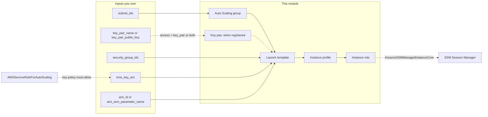

# aws.modules.ec2 (AWS EC2 Auto Scaling fleet)

Provisions one private EC2 fleet per module call: a launch template, an Auto Scaling group, and, unless you bring your own, the instance role and instance profile the instances run under. A single instance is a group with `min_size = max_size = 1`; there is no separate single-instance mode, so an instance that fails is always replaced. The module is secure by default and the defaults that matter are not inputs: IMDSv2 is required, every volume the module declares is encrypted, instances get no public IPv4 address, and there is no key pair by default, so the way in is SSM Session Manager through the instance role. A key pair is an explicit opt-in through `access` (see [Choosing how to get in](#choosing-how-to-get-in)); Session Manager stays the platform standard. Requires Terraform >= 1.7 and the AWS provider >= 6.35, < 7.

> [!IMPORTANT]
> **Status: `v0.1.1`, pre-1.0. Applied live once, in a sandbox account on 2026-10-15, and destroyed afterwards; see [Live evidence](tests/integration/README.md#live-evidence-2026-10-15).** The integration suite passed there (5 of 5) and a second small stack exercised the module registering its own key pair, rotating it, and a rolling refresh. That run used administrator credentials, so the least-privilege CI role is untested, and several paths are not proven (they are listed in the evidence section). The 97 contract tests run against `mock_provider`; a statement below marked as inferred has not been observed. The `v0.x` line signals that the interface may still change in a minor version until `v1.0.0`; see [Versioning and releases](#versioning-and-releases).

## Why this module

What you get from `name`, `subnet_ids`, `security_group_ids`, an image, and an `instance_type`:

- One launch template and one Auto Scaling group. The group follows the launch template's latest version, so any template change (AMI ID, `user_data`, key pair, volume settings, security groups, tags) rolls the fleet through a rolling `instance_refresh` unless you disable it.
- IMDSv2 required (`http_tokens = "required"`) with a hop limit of 1 and instance metadata tags off; no input relaxes any of it. `metadata_hop_limit` may be raised to 2 for containers that run on the instance, which gives every container on the instance the role's credentials.
- A 30 GiB encrypted `gp3` root volume that is deleted with the instance, plus optional additional encrypted volumes keyed by a stable name. Volumes use `kms_key_arn` when set, or the AWS managed `aws/ebs` key with an advisory check when it is not. The encryption covers the volumes the module declares; see [Security model](#security-model) for what that leaves out.
- No public IPv4: the primary network interface is declared explicitly with `associate_public_ip_address = false`, so a subnet with `map_public_ip_on_launch = true` cannot give instances an address. IPv6 follows the subnet.
- `access` chooses how operators get a shell: `ssm` (default), `key_pair`, or `both`. A key pair is either an existing one (`key_pair_name`) or a public key the module registers (`key_pair_public_key`); the module never generates key material, so no private key reaches Terraform state.
- An instance role and instance profile named `<name>-instance` that trust only `ec2.amazonaws.com` (`ec2.amazonaws.com.cn` in `aws-cn`) and, when `access` includes `ssm`, carry `AmazonSSMManagedInstanceCore`. Bring your own with `create_instance_profile = false` and `iam_instance_profile_name`, and the module creates no IAM at all.
- The image as either `ami_id` (pinned; changing it rolls the fleet) or `ami_ssm_parameter_name` (resolved by EC2 at launch; the parameter moving does not roll the fleet). Exactly one must be set.
- `desired_capacity = null` by default, so the instance count belongs to AWS and a scaling event is not drift.
- Optional CPU target tracking (`target_tracking_cpu_percent`) and optional load balancer registration (`target_group_arns`, `health_check_type = "ELB"`).
- Plan-time validation of identifier shapes, ranges, and the combinations listed under [Security model](#security-model), with messages that name the input to change, and seven advisory `check` blocks for configurations that are valid but usually unintended. Anything that needs an AWS API call (does the AMI exist, does the key policy allow the Auto Scaling role) cannot be checked at plan time.
- One data source, `aws_partition`, which makes no API call and is skipped when you pass `partition`.

## Quick start

```hcl
module "orders_worker" {
  source = "git::https://github.com/hatan4ik/aws.modules.ec2.git?ref=<commit-sha>" # v0.1.0

  name                   = "orders-worker"
  subnet_ids             = ["subnet-0a1b2c3d4e5f60001", "subnet-0a1b2c3d4e5f60002"]
  security_group_ids     = ["sg-0a1b2c3d4e5f60001"]
  ami_ssm_parameter_name = "/aws/service/ami-amazon-linux-latest/al2023-ami-kernel-default-arm64"
  instance_type          = "t4g.small"

  kms_key_arn = "arn:aws:kms:us-east-2:123456789012:key/11111111-2222-3333-4444-555555555555"

  # A one-instance group launches the replacement before it terminates the
  # old instance only with these two values; see Failure modes.
  instance_refresh = { min_healthy_percentage = 100, max_healthy_percentage = 200 }

  tags = { Environment = "prod", Owner = "orders" }
}
```

This creates one launch template, one Auto Scaling group named `orders-worker` with `min_size = max_size = 1` spread over the two subnets, the role and instance profile `orders-worker-instance` with `AmazonSSMManagedInstanceCore`, and no scaling policy. `access` is `ssm`, so there is no key pair. Open a shell with `aws ssm start-session --target <instance-id>`. Reference the fleet through `module.orders_worker.autoscaling_group_name`, `module.orders_worker.launch_template_id`, and `module.orders_worker.iam_role_name` (to attach further policies).

### Composing with the rest of the fleet

The module does not create subnets, security groups, or KMS keys. It takes `subnet_ids`, `security_group_ids`, and `kms_key_arn`, so compose it with `aws.modules.vpc`, `aws.modules.security-group`, and `aws.modules.kms`.

A customer managed key that encrypts volumes launched by an Auto Scaling group must allow the Auto Scaling service-linked role. `aws.modules.kms` has a `service_grants` preset for exactly that, `autoscaling-ebs`:

```hcl
# Only needed in an account that has never created an Auto Scaling group:
# KMS rejects a key policy that names a role which does not exist yet.
resource "aws_iam_service_linked_role" "autoscaling" {
  aws_service_name = "autoscaling.amazonaws.com"
}

module "orders_key" {
  # The preset first shipped in aws.modules.kms v2.1.0.
  source = "git::https://github.com/hatan4ik/aws.modules.kms.git?ref=66f78e1c4ef81a3fbf36af8133f4a632a2e80f27" # v2.1.0

  description = "EBS key for the orders-worker fleet"
  aliases     = ["orders/ebs"]
  account_id  = "123456789012"
  partition   = "aws"

  service_grants = {
    AutoScalingEbs = { service = "autoscaling-ebs" }
  }

  depends_on = [aws_iam_service_linked_role.autoscaling]
}

module "orders_worker" {
  source = "git::https://github.com/hatan4ik/aws.modules.ec2.git?ref=<commit-sha>" # v0.1.0

  name                   = "orders-worker"
  subnet_ids             = values(module.vpc.subnet_ids_by_tier["private"])
  security_group_ids     = [var.worker_security_group_id] # from aws.modules.security-group
  ami_ssm_parameter_name = "/aws/service/ami-amazon-linux-latest/al2023-ami-kernel-default-arm64"
  instance_type          = "t4g.small"
  kms_key_arn            = module.orders_key.arn
  instance_refresh       = { min_healthy_percentage = 100, max_healthy_percentage = 200 }
}
```

The preset renders two statements, `AutoScalingEbs` (`kms:Encrypt`, `kms:Decrypt`, `kms:ReEncrypt*`, `kms:GenerateDataKey*`, `kms:DescribeKey`) and `AutoScalingEbsAttachPersistentResources` (`kms:CreateGrant` under `kms:GrantIsForAWSResource = true`) for `AWSServiceRoleForAutoScaling`. KMS accepted the policy this call renders in a live apply on 2026-10-15, after the Auto Scaling service-linked role had been created (it did not exist in that account).

If you pin an `aws.modules.kms` release before v2.1.0, `policy_statements` is the fallback that renders the same two statements:

```hcl
  policy_statements = {
    AllowAutoScalingUse = {
      principals = { AWS = ["arn:aws:iam::123456789012:role/aws-service-role/autoscaling.amazonaws.com/AWSServiceRoleForAutoScaling"] }
      actions    = ["kms:Encrypt", "kms:Decrypt", "kms:ReEncrypt*", "kms:GenerateDataKey*", "kms:DescribeKey"]
    }
    AllowAutoScalingGrant = {
      principals = { AWS = ["arn:aws:iam::123456789012:role/aws-service-role/autoscaling.amazonaws.com/AWSServiceRoleForAutoScaling"] }
      actions    = ["kms:CreateGrant"]
      conditions = [{ test = "Bool", variable = "kms:GrantIsForAWSResource", values = ["true"] }]
    }
  }
```

When the key is created in the same plan, `kms_key_arn` is unknown until apply, so the `volumes_use_aws_managed_key` check cannot be evaluated at plan time and reports that its result is known after apply. That is a note, not a failure.

The service-linked role is created by AWS the first time an Auto Scaling group exists in the account, or explicitly with `aws_iam_service_linked_role`; a key policy can name it only after it exists. See [Failure modes](#failure-modes) for what happens without the key policy statements.

## Choosing how to get in

`access` decides how an operator gets a shell. Session Manager is the default and the platform standard; a key pair is opt-in and exists for workloads that genuinely need SSH.

| `access` | What the module creates or sets | What you must still do |
| --- | --- | --- |
| `ssm` (default) | No key pair; no `key_name` on the launch template. The created role carries `AmazonSSMManagedInstanceCore` (`iam_attach_ssm_managed_policy = null` follows `access`). | Give the instances a network path to the Systems Manager endpoints (`ssm`, `ssmmessages`, `ec2messages` through NAT or VPC interface endpoints) and an AMI with the SSM agent. Restrict who holds `ssm:StartSession`. Configure Session Manager preferences if you need session logs. |
| `key_pair` | `key_name` is set on the launch template: the existing key pair named by `key_pair_name`, or a key pair named after the fleet (`<name>`) that the module registers from `key_pair_public_key`. The SSM managed policy is **not** attached unless `iam_attach_ssm_managed_policy = true`. | Add an inbound TCP 22 rule to one of `security_group_ids`, from a bastion or VPN range and never `0.0.0.0/0` (`aws.modules.security-group`). Reach the instance over a private path: it has no public IPv4. Keep the private key out of Terraform. |
| `both` | The key pair as above, and the SSM managed policy attached. | Both rows above. |

Rules the module enforces (preconditions, so they fail at plan time):

- `key_pair_name` and `key_pair_public_key` are set exactly when `access` is `key_pair` or `both`, and exactly one of them is set then.
- `key_pair_public_key` must be a single OpenSSH `ssh-rsa` or `ssh-ed25519` line known at plan time. A private key is rejected by validation: pass the `.pub` file. The module never generates a key and no private key reaches state; the public key itself is not secret.
- With `create_instance_profile = false` the supplied profile is responsible for SSM permissions when `access` includes `ssm`; `iam_attach_ssm_managed_policy` and the other `iam_*` role inputs are rejected.

A key pair alone opens nothing. Without the inbound rule the instance is not reachable over SSH, and the module does not create it. Outputs `access` and `key_pair_name` report what was chosen (`key_pair_name` is null when `access = ssm`).

```hcl
module "legacy_batch" {
  source = "git::https://github.com/hatan4ik/aws.modules.ec2.git?ref=<commit-sha>" # v0.1.0

  name                   = "legacy-batch"
  subnet_ids             = ["subnet-0a1b2c3d4e5f60001", "subnet-0a1b2c3d4e5f60002"]
  security_group_ids     = ["sg-0a1b2c3d4e5f60001"] # must carry the port 22 rule from your bastion range
  ami_ssm_parameter_name = "/aws/service/ami-amazon-linux-latest/al2023-ami-kernel-default-arm64"
  instance_type          = "t4g.small"
  kms_key_arn            = "arn:aws:kms:us-east-2:123456789012:key/11111111-2222-3333-4444-555555555555"

  access              = "both" # keep Session Manager; "key_pair" drops the SSM policy
  key_pair_public_key = file("${path.module}/keys/legacy-batch.pub")

  instance_refresh = { min_healthy_percentage = 100, max_healthy_percentage = 200 }
}
```

## Architecture

```text
root (one fleet)
├── data.aws_partition.current[0]            Only when partition is null; reads provider configuration, no API call.
├── aws_key_pair.this[0]                     Only when access includes a key pair and key_pair_public_key is set.
├── aws_launch_template.this                 Image, type, IMDSv2, key pair name, volumes, network interface, instance profile, tags.
├── aws_autoscaling_group.this               Sizes, subnets, health checks, rolling instance_refresh; runs the template's latest version.
├── aws_autoscaling_policy.cpu[0]            Only when target_tracking_cpu_percent is set.
├── aws_iam_role.this[0]                     Only when create_instance_profile is true.
├── aws_iam_role_policy_attachment.ssm[0]    AmazonSSMManagedInstanceCore; attached when access includes ssm, or iam_attach_ssm_managed_policy = true.
├── aws_iam_role_policy_attachment.additional["<label>"]   One per iam_policy_arns entry.
├── aws_iam_role_policy.inline["<policy name>"]            One per iam_inline_policies entry.
└── aws_iam_instance_profile.this[0]         Referenced by name from the launch template.
```



The launch template carries everything that defines an instance. The group references `aws_launch_template.this.latest_version`, so a template change produces a new version, the group points at it, and `instance_refresh` replaces the running instances. The group `depends_on` the role's policy attachments, so the role's policies exist before the first instance boots and are detached only after the group is gone. The role, profile, and policy attachments live in `iam.tf` and are skipped entirely when `create_instance_profile = false`.

| Concern | Managed by default | Bring your own |
| --- | --- | --- |
| Instance profile and role | Created as `<name>-instance`, trusting `ec2.amazonaws.com` (or `.com.cn` in `aws-cn`), with `AmazonSSMManagedInstanceCore` when `access` includes `ssm`. Extended with `iam_policy_arns` (a map keyed by a static label), `iam_inline_policies` (a map keyed by policy name), `iam_permissions_boundary_arn`, `iam_role_path`. | `create_instance_profile = false` and `iam_instance_profile_name`. Every `iam_*` role input is then rejected by a precondition, and the profile must grant SSM access itself when `access` includes `ssm`. The module never modifies a profile you supply. |
| Key pair | None (`access = "ssm"`). | `key_pair_name` for an existing key pair, or `key_pair_public_key` for the module to register one named `<name>`. |
| Subnets | None. | `subnet_ids`, 1-20 IDs; use at least two zones for a fleet that must survive an AZ loss (the `single_subnet` check warns otherwise). |
| Security groups | None. | `security_group_ids`, 1-5 IDs, attached to the primary network interface. SSH needs a port 22 rule in one of them. |
| Volume encryption key | The AWS managed `aws/ebs` key, with the `volumes_use_aws_managed_key` check raised. | `kms_key_arn` for every declared volume, overridable per volume with `root_volume.kms_key_arn` and `ebs_volumes[*].kms_key_arn`. Multi-Region `mrk-` keys are accepted. |
| Image | None; one input is required. | `ami_id` (pinned) or `ami_ssm_parameter_name` (resolved at launch). |
| Instance count | `desired_capacity = null`: the group starts at `min_size` and AWS owns the count afterwards. | `desired_capacity` for a fleet deliberately sized by Terraform, or `target_tracking_cpu_percent` for CPU-driven scaling. |
| Region and partition | The provider's Region and `aws_partition`. | `region` pins the key pair, launch template, group, and policy; `partition` (`aws`, `aws-us-gov`, `aws-cn`) skips the data source. IAM is global and ignores `region`. |

## Usage patterns

| Example | What it shows |
| --- | --- |
| [`examples/minimal`](examples/minimal) | The smallest working fleet: a name, an `ami_ssm_parameter_name`, an instance type, one subnet and one security group. One instance, module-created role and profile, `access = "ssm"`, AWS managed EBS key (the advisory checks warn about it and the single subnet). |
| [`examples/single-instance`](examples/single-instance) | `min_size = max_size = 1` with a pinned `ami_id` and `instance_refresh = { min_healthy_percentage = 100, max_healthy_percentage = 200 }`, so a template change launches the replacement before the old instance is terminated. |
| [`examples/complete`](examples/complete) | A customer managed key, a sized root volume and one additional `ebs_volumes` entry, `user_data`, either an existing instance profile or a created role with extra policies and a boundary, two to six instances on CPU target tracking, and load balancer registration with `health_check_type = "ELB"`. |
| [`examples/ssh-key-pair`](examples/ssh-key-pair) | `access = "both"` with a key pair the module registers from a public key you supply, so Session Manager and SSH both work. The port 22 security group rule is composed from `aws.modules.security-group`, not created by this module. |

## Security model

Defaults and the input, if any, that changes them:

| Property | Setting | Input to change it |
| --- | --- | --- |
| Instance metadata service | `http_tokens = "required"` (IMDSv2 only), `http_endpoint = "enabled"`, `instance_metadata_tags = "disabled"` | None. Only `metadata_hop_limit` (1 or 2) is tunable. |
| Volume encryption | `encrypted = true` on the root volume and on every `ebs_volumes` entry the module declares. A volume the AMI defines under another device name is not covered unless account-level EBS encryption by default is on. | None. `kms_key_arn` only selects the key. |
| Public address | `associate_public_ip_address = false` on an explicit primary network interface (`device_index = 0`): no public IPv4. IPv6 follows the subnet. | None. |
| EBS optimization | Not set by the module; the EC2 default for the instance type applies. | None. |
| Key pair | No `key_name` unless `access` is `key_pair` or `both`. The module registers a public key or references an existing key pair; it never generates one. | `access`, `key_pair_name`, `key_pair_public_key`. |
| Session Manager | The SSM managed policy is attached to the created role when `access` includes `ssm`. | `access`, `iam_attach_ssm_managed_policy`. |
| Instance trust policy | The created role trusts `ec2.amazonaws.com` (`ec2.amazonaws.com.cn` in `aws-cn`) for `sts:AssumeRole` only. | None. |
| Role permissions | The SSM managed policy when selected, nothing else. | `iam_policy_arns`, `iam_inline_policies`, `iam_permissions_boundary_arn`, or `create_instance_profile = false`. |
| Detailed monitoring | Off | `detailed_monitoring`. |
| Volume deletion | Root volume is deleted with the instance | `ebs_volumes[*].delete_on_termination` for additional volumes only. |

What is validated or warned about at plan time:

- **Variable validation:** shapes and ranges. Subnet IDs (`subnet-...`), security group IDs (`sg-...`), AMI IDs (`ami-...`), snapshot IDs (`snap-...`), full KMS key ARNs including multi-Region `mrk-` keys (aliases and bare key IDs are rejected because the module needs the full ARN to validate it at plan time), IAM managed policy ARNs, target group ARNs, device names, volume types with their `iops`, `throughput`, and size rules (gp3 `iops` 3000-16000; io1 100-64000 and io2 100-256000, required for both; st1 and sc1 at least 125 GiB), the `instance_refresh` percentages (the gap between `max_healthy_percentage` and `min_healthy_percentage` is at most 100), the OpenSSH public key shape, `partition` (`aws`, `aws-us-gov`, `aws-cn`), and the `name` pattern.
- **Preconditions:** exactly one of `ami_id` and `ami_ssm_parameter_name`; `iam_instance_profile_name` set exactly when `create_instance_profile` is false; no role inputs when it is false; the key pair inputs consistent with `access`; `min_size <= max_size`; `desired_capacity` within `min_size` and `max_size`.
- **Advisory checks** (warn on every plan and apply, never block): `volumes_use_aws_managed_key`, `single_subnet`, `elb_health_check_without_target_groups`, `no_way_into_the_instances`, `target_tracking_cannot_scale`, `single_instance_refresh_has_downtime`, `broad_instance_role`. `no_way_into_the_instances` accepts a selected key pair as a way in. `broad_instance_role` is a text match on `AdministratorAccess`, `PowerUserAccess`, and `IAMFullAccess` ARNs and on an inline `"Action": "*"` (or a list whose first element is `"*"`); it is not a policy analyser.

What the module does not police, and what you own:

- **Who can open a shell.** With `ssm`, anyone allowed `ssm:StartSession` on an instance gets a shell as `ssm-user`, which is a sudoer. Scope that permission by tag or resource. Sessions are not logged unless Session Manager preferences are configured (CloudWatch Logs or S3, encrypted with KMS); the module does not configure them. With a key pair, the private key is the credential: it is shared, long-lived, and not tied to a person.
- **Tags are metadata, not secrets.** Caller `tags` are copied to the role, profile, key pair, launch template, instances, volumes, and network interfaces, and are readable by anyone who can describe them. Provider `default_tags` do **not** reach the instances, volumes, or network interfaces the group launches: only the module's `tags` do, so put cost-allocation tags in `tags`.
- **`user_data`.** It is stored in Terraform state and plan output, kept in every older launch template version, readable through the EC2 API, and readable by any local process on the instance through the metadata service. Never put secrets in it: fetch them at boot from Secrets Manager or SSM Parameter Store with the instance role.
- **Image provenance.** The AMI owner is part of your trust boundary and the module does not check it (restrict AMIs with an SCP or the EC2 Allowed AMIs setting). A private SSM parameter used as `ami_ssm_parameter_name` is controlled by whoever can write it: they decide what every new instance boots.
- **Hop limit 2.** Every container on an instance with `metadata_hop_limit = 2` can obtain the instance role's credentials. Keep that role minimal; the `broad_instance_role` check warns about the obvious cases.
- **Volumes the AMI defines.** `root_volume.device_name` must match the AMI's root device: `/dev/xvda` for Amazon Linux and Bottlerocket, `/dev/sda1` for Ubuntu and Debian. A wrong name adds a second, module-declared volume and the AMI's real root volume launches under the AMI's own settings. Other AMI-defined volumes (check the image's `BlockDeviceMappings` with `aws ec2 describe-images`) are likewise not covered unless you declare them in `ebs_volumes` under the same device name or turn on account-level EBS encryption by default.
- **Snapshot restores.** The module requests `encrypted = true` and the key for a volume restored from `snapshot_id`. AWS may refuse to launch from an unencrypted snapshot with that setting; that behaviour has not been verified, and if it happens it fails at launch, not at plan.
- **A supplied profile, key pair, key policy, security group rules, and AMI.** The module cannot see a profile's permissions, the key policy of `kms_key_arn`, the security group rules, or whether the AMI exists and matches the instance type's architecture.
- **`iam_inline_policies` and `iam_policy_arns`** are applied as written. The module neither widens nor narrows them.

## Failure modes

**The key policy must allow the Auto Scaling service-linked role, and the role must exist first.** When a customer managed key encrypts volumes launched by an Auto Scaling group, the key policy must allow `AWSServiceRoleForAutoScaling`: `kms:Encrypt`, `kms:Decrypt`, `kms:ReEncrypt*`, `kms:GenerateDataKey*`, `kms:DescribeKey`, and `kms:CreateGrant` with `kms:GrantIsForAWSResource = true`. Without it the group cannot launch instances, which shows up as failed scaling activities rather than as a Terraform error on the key, and, when `min_size` is above 0, `terraform apply` waits out `wait_for_capacity_timeout` (10 minutes by default) before failing. The instance role does not help: the service-linked role makes the launch call. KMS rejects a key policy that names a role that does not exist, and an account that has never created an Auto Scaling group has no `AWSServiceRoleForAutoScaling` until you create it (`aws_iam_service_linked_role` for `autoscaling.amazonaws.com`) or the first group is created. Use the `autoscaling-ebs` preset of `aws.modules.kms` (see [Composing](#composing-with-the-rest-of-the-fleet)); setting `kms_key_arn = null` avoids the problem by using the AWS managed `aws/ebs` key, at the cost of the `volumes_use_aws_managed_key` check. Details in [docs/DESIGN.md](docs/DESIGN.md#kms-key-policy-for-the-auto-scaling-service-linked-role).

**A one-instance group has an outage window during a refresh unless you ask otherwise.** With the default `instance_refresh` (`min_healthy_percentage = 90`, no `max_healthy_percentage`) a group of one instance has an outage window while the replacement boots: the group can terminate the instance before the replacement is in service, so a template change is an outage for the boot time. Set `instance_refresh = { min_healthy_percentage = 100, max_healthy_percentage = 200 }` and the group launches the replacement first; that is the documented way to do it. The two values must be set together: `max_healthy_percentage` may be at most 100 points above `min_healthy_percentage`, so `{ max_healthy_percentage = 200 }` alone (default min 90) is rejected at plan time. The `single_instance_refresh_has_downtime` check fires on a group with `max_size = 1` that does not have min 100 and max 200; it does not look at a larger group that happens to run one instance. `instance_refresh.enabled = false` turns refresh off entirely and leaves old instances running until something else replaces them. With `protect_from_scale_in = true` the module sets `scale_in_protected_instances = "Refresh"` so protected instances are rolled as well. Observed on 2026-10-15: with min 100 and max 200, a launch template change launched the replacement before the old instance terminated (the scaling activity history shows the launch first). The default 90 band, `protect_from_scale_in`, and the check on a live group have not been observed.

**SSH needs a security group rule the module does not create.** `access = "key_pair"` or `"both"` sets the key pair on the launch template and nothing else. Without an inbound TCP 22 rule in one of `security_group_ids`, from a bastion or VPN range, the instance cannot be reached over SSH. The instance has no public IPv4, so the path is a private one. Never open port 22 to `0.0.0.0/0`.

**A key pair registered from `key_pair_public_key` gets a generated name.** The module registers it with `key_name_prefix = "<name>-"`, so AWS appends a unique suffix; read the real name from the `key_pair_name` output. The launch template is `create_before_destroy` and Terraform extends that to what it depends on, so a fixed name would collide when the key changes, which is why a prefix is used. Observed on 2026-10-15: changing the public key created the new key pair, updated the launch template, deleted the old key pair, and rolled the fleet, with no collision. The `key_name` is read at instance launch only: a key pair change reaches running instances only through the refresh.

**`access = "key_pair"` leaves the role without SSM permissions.** The SSM managed policy is attached only when `access` includes `ssm` or you set `iam_attach_ssm_managed_policy = true`, so a fleet on `key_pair` has no Session Manager fallback if the key or the port 22 path is lost; the fix is a replacement instance or a change to `access`. The `no_way_into_the_instances` check covers the created role with no policy and no key pair at all; it cannot see the network path, the agent, or the port 22 rule.

**`ami_ssm_parameter_name` does not roll the fleet.** The module passes `resolve:ssm:<parameter>` to the launch template and EC2 resolves it at launch. When the parameter moves to a new AMI, the launch template does not change, so there is no plan diff and no refresh; running instances keep the old AMI, and the next instance that launches for any reason (scale out, health replacement) gets the new one, which leaves a mixed-AMI fleet. Use `ami_id` when the AMI must be pinned and a change must be a reviewed diff that rolls the fleet. The `image_id` output reports whichever form is in use.

**The instance profile and role names are `<name>-instance`, and IAM is global.** Two module calls with the same `name` in one account collide on the role and the profile even when they run in different Regions, because `region` does not apply to IAM. Use distinct names, or create the profile once and pass it to both with `create_instance_profile = false` and `iam_instance_profile_name`. Changing `name` renames the role and profile, which replaces them.

**Changing `iam_role_path` replaces the role and profile under the same names.** `path` forces replacement of both, the names do not change, and the launch template's `create_before_destroy` makes Terraform create the replacements first, which IAM rejects while the old ones exist. To change the path, rename the fleet or destroy and recreate it. This follows from how Terraform orders replacements and has not been observed.

**SSM can be unreachable for reasons the module cannot see.** An instance whose role lacks SSM permissions, whose AMI has no SSM agent, or whose subnet has no route to the Systems Manager endpoints (`ssm`, `ssmmessages`, `ec2messages`, through NAT or VPC interface endpoints) cannot be reached by Session Manager at all; the fix is a replacement instance or a network change, not a login.

**Changing `name` replaces the Auto Scaling group.** `name` is the group's name and its identity, and group names are unique, so the old group is destroyed before the new one is created. Renaming terminates every instance. To rename without an outage, create a second module call with the new name, move traffic, and remove the old call.

**Any launch template change rolls the fleet.** `user_data`, tags, key pair, volume settings, security groups, hop limit, and the AMI ID all produce a new template version and a refresh. With `instance_refresh.enabled = false` the new version applies only to instances launched afterwards.

**`desired_capacity` is yours or AWS's, not both.** Leave it null for a fleet that scales. Setting it makes Terraform reset the count on every apply; the module also checks that it lies within `min_size` and `max_size`.

**Architecture mismatch and unsupported types fail at launch, not at plan.** `instance_type` and the image must agree (for example `m7g.large` needs an arm64 AMI). The module cannot check this, nor whether the type supports EBS optimization, which the module no longer forces; the failure appears in the group's scaling activity.

## Testing

Two layers, deliberately separate:

- **Contract tests** (`tests/*.tftest.hcl`, run by `make test` and by CI) use `mock_provider "aws"`: no credentials, nothing created, placeholder identifiers such as the AWS documentation account `123456789012`. 97 `run` blocks across seven files (`defaults`, `iam`, `keypair`, `scaling`, `storage`, `checks`, `validation`) pin the secure defaults, fleet defaults, access and key pair variants, IAM variants, scaling and refresh settings, volume and key resolution, every validation, and each advisory check. They prove the module renders what it claims; they cannot prove that AWS accepts it.
- **Integration suite** (`tests/integration/`, run by `make integration-smoke` or the dispatch-only `integration` workflow) is meant to apply the module for real in **your** account with **your** credentials and Region from the environment and destroy everything afterwards. It is never part of `make check`. **One real apply is recorded** (2026-10-15, administrator credentials, a sandbox account): 5 of 5 passed and everything was destroyed afterwards; see [Live evidence](tests/integration/README.md#live-evidence-2026-10-15). The suite has not run under the least-privilege CI role, and the paths that are not proven are listed there. See [`tests/integration/README.md`](tests/integration/README.md).

```bash
terraform init -backend=false -input=false
terraform test        # or: make test
```

## Compatibility and scope

- Terraform `>= 1.7.0, < 2.0.0`. AWS provider `>= 6.35.0, < 7.0.0`. The committed lock file resolves provider 6.69.0 and the tests were run with Terraform 1.7.5.
- `partition` accepts `aws`, `aws-us-gov`, and `aws-cn`; the isolated partitions are not supported. The role trusts `ec2.amazonaws.com.cn` in `aws-cn`. Tests assert the default (`aws`) and the `aws-cn` rendering; `aws-us-gov` is not asserted, and no partition has been applied.
- The module is Region-agnostic. The platform that consumes it restricts Regions to the United States; that rule is recorded in `docs/ARCHITECTURE.md` of the `devops-aws-infra` platform repository, and is a platform rule, not a module check.
- `kms_key_arn` and the per-volume overrides must be full KMS key ARNs, single-Region or multi-Region (`mrk-`). Aliases and bare key IDs are rejected so the value can be validated at plan time.

What the module deliberately does **not** do:

- **Security groups, subnets, and KMS keys.** It takes `security_group_ids`, `subnet_ids`, and `kms_key_arn`. Compose `aws.modules.security-group`, `aws.modules.vpc`, and `aws.modules.kms`. That includes the port 22 rule SSH needs.
- **Generate key material.** `key_pair_public_key` takes a public key; there is no `tls_private_key` and no private key output.
- **Session Manager preferences or session logging.** Document and configure those where Session Manager is configured for the account.
- **Load balancers.** `target_group_arns` registers the group with target groups you created, for example from `aws.modules.alb`; the module does not create an ALB, listener, or target group.
- **Spot or mixed instances.** One instance type, on demand. There is no `mixed_instances_policy` and no `instance_requirements`.
- **Lifecycle hooks and warm pools.** Neither is exposed.
- **Scheduled actions, step scaling, and notifications.** The only scaling policy is CPU target tracking.
- **A standalone `aws_instance`.** There is no resource for a bare instance; use `min_size = max_size = 1`.
- **Look up or verify the AMI, its owner, or its block device mappings.**
- **Tag instances through the provider's `default_tags`.** Only the module's `tags` reach instances, volumes, and network interfaces.

## Versioning and releases

Releases follow semantic versioning: incompatible interface changes bump the major version, new optional inputs and outputs bump the minor version, fixes bump the patch version. Every release is a signed annotated tag `vX.Y.Z`. The first release is `v0.1.0`. While the major version is 0, a minor version may change the interface; `v1.0.0` is intended to follow a run of the suite under the least-privilege CI role and a decision on the paths still marked not proven.

Pin the full commit SHA of the release tag and record the tag in a comment, so the source cannot move under you:

```hcl
module "orders_worker" {
  source = "git::https://github.com/hatan4ik/aws.modules.ec2.git?ref=<commit-sha>" # v0.1.0
}
```

The `module-release` workflow publishes an immutable GitHub release only from a GitHub-verified, signed, annotated semantic-version tag that points at the merged `main` revision; lightweight or unsigned tags are rejected before anything is published. With a GitHub-associated GPG or SSH signing key configured:

```bash
git fetch origin
git tag -s vX.Y.Z <commit> -m "vX.Y.Z"
git push origin vX.Y.Z
gh workflow run module-release.yml --ref vX.Y.Z -f release_tag=vX.Y.Z
```

Dispatch from the tag, never from `main`. All changes are listed in [CHANGELOG.md](CHANGELOG.md).

## Contributing

Development setup, the local quality gate, the test-first workflow, and the release process are described in [CONTRIBUTING.md](CONTRIBUTING.md). Security reports go through [SECURITY.md](SECURITY.md). The reasoning behind the design, including the alternatives that were rejected, is in [docs/DESIGN.md](docs/DESIGN.md).

## License

Apache-2.0. See [LICENSE](LICENSE).

<!-- BEGIN_TF_DOCS -->
## Requirements

| Name | Version |
|------|---------|
| <a name="requirement_terraform"></a> [terraform](#requirement\_terraform) | >= 1.7.0, < 2.0.0 |
| <a name="requirement_aws"></a> [aws](#requirement\_aws) | >= 6.35.0, < 7.0.0 |

## Providers

| Name | Version |
|------|---------|
| <a name="provider_aws"></a> [aws](#provider\_aws) | >= 6.35.0, < 7.0.0 |

## Modules

No modules.

## Resources

| Name | Type |
|------|------|
| [aws_autoscaling_group.this](https://registry.terraform.io/providers/hashicorp/aws/latest/docs/resources/autoscaling_group) | resource |
| [aws_autoscaling_policy.cpu](https://registry.terraform.io/providers/hashicorp/aws/latest/docs/resources/autoscaling_policy) | resource |
| [aws_iam_instance_profile.this](https://registry.terraform.io/providers/hashicorp/aws/latest/docs/resources/iam_instance_profile) | resource |
| [aws_iam_role.this](https://registry.terraform.io/providers/hashicorp/aws/latest/docs/resources/iam_role) | resource |
| [aws_iam_role_policy.inline](https://registry.terraform.io/providers/hashicorp/aws/latest/docs/resources/iam_role_policy) | resource |
| [aws_iam_role_policy_attachment.additional](https://registry.terraform.io/providers/hashicorp/aws/latest/docs/resources/iam_role_policy_attachment) | resource |
| [aws_iam_role_policy_attachment.ssm](https://registry.terraform.io/providers/hashicorp/aws/latest/docs/resources/iam_role_policy_attachment) | resource |
| [aws_key_pair.this](https://registry.terraform.io/providers/hashicorp/aws/latest/docs/resources/key_pair) | resource |
| [aws_launch_template.this](https://registry.terraform.io/providers/hashicorp/aws/latest/docs/resources/launch_template) | resource |
| [aws_partition.current](https://registry.terraform.io/providers/hashicorp/aws/latest/docs/data-sources/partition) | data source |

## Inputs

| Name | Description | Type | Default | Required |
|------|-------------|------|---------|:--------:|
| <a name="input_access"></a> [access](#input\_access) | How operators reach the instances. ssm (default, the platform standard): Session Manager through the instance role; no key pair, no inbound rule needed. key\_pair: SSH with an EC2 key pair; the SSM managed policy is not attached unless iam\_attach\_ssm\_managed\_policy = true. both: Session Manager and SSH. A key pair alone opens nothing: SSH also needs an inbound rule on port 22 in one of security\_group\_ids, which this module does not create (use aws.modules.security-group, from a bastion or VPN range, never 0.0.0.0/0). | `string` | `"ssm"` | no |
| <a name="input_ami_id"></a> [ami\_id](#input\_ami\_id) | AMI ID to launch. Exactly one of ami\_id and ami\_ssm\_parameter\_name must be set. An AMI ID is immutable, so changing it is a reviewed launch template change and rolls the fleet. The module does not check who owns the AMI: AMI provenance is part of your trust boundary (restrict it with an SCP or the EC2 Allowed AMIs setting). | `string` | `null` | no |
| <a name="input_ami_ssm_parameter_name"></a> [ami\_ssm\_parameter\_name](#input\_ami\_ssm\_parameter\_name) | Public or private SSM parameter that holds the AMI ID, resolved by EC2 when an instance launches (for example /aws/service/ami-amazon-linux-latest/al2023-ami-kernel-default-arm64). The parameter moving does NOT change the launch template, so it does not roll the fleet by itself; use ami\_id when the AMI must be pinned. Whoever can write a private parameter controls what every new instance boots. Exactly one of ami\_id and ami\_ssm\_parameter\_name must be set. | `string` | `null` | no |
| <a name="input_create_instance_profile"></a> [create\_instance\_profile](#input\_create\_instance\_profile) | Create a role and instance profile named <name>-instance. Set false to attach an existing profile through iam\_instance\_profile\_name. This is its own input, not derived from iam\_instance\_profile\_name being null, so the module still plans when the profile name is computed in the same apply. | `bool` | `true` | no |
| <a name="input_desired_capacity"></a> [desired\_capacity](#input\_desired\_capacity) | Desired number of instances. Null leaves the count to AWS (the group starts at min\_size and a scaling policy keeps it), so a later scaling event does not show up as drift. Set it only for a fleet that is deliberately sized by Terraform. | `number` | `null` | no |
| <a name="input_detailed_monitoring"></a> [detailed\_monitoring](#input\_detailed\_monitoring) | Publish instance metrics at one-minute instead of five-minute granularity. Billed per instance. | `bool` | `false` | no |
| <a name="input_ebs_volumes"></a> [ebs\_volumes](#input\_ebs\_volumes) | Additional EBS volumes keyed by a stable name, attached to every instance at launch. device\_name is the block device name: /dev/sdf through /dev/sdp, or /dev/xvdb through /dev/xvdd with an optional trailing letter. delete\_on\_termination defaults to true. snapshot\_id restores from a snapshot; the module still requests encrypted = true (and the key), and a restore that AWS refuses fails at launch, not at plan. kms\_key\_arn overrides the module-level key. | <pre>map(object({<br/>    device_name           = string<br/>    size_gib              = number<br/>    type                  = optional(string, "gp3")<br/>    iops                  = optional(number)<br/>    throughput            = optional(number)<br/>    kms_key_arn           = optional(string)<br/>    snapshot_id           = optional(string)<br/>    delete_on_termination = optional(bool, true)<br/>  }))</pre> | `{}` | no |
| <a name="input_health_check_grace_period"></a> [health\_check\_grace\_period](#input\_health\_check\_grace\_period) | Seconds after launch before health checks start counting. Size it to the boot time of the workload. | `number` | `300` | no |
| <a name="input_health_check_type"></a> [health\_check\_type](#input\_health\_check\_type) | EC2 replaces instances that fail EC2 status checks; ELB also replaces instances that a load balancer target group reports unhealthy (set target\_group\_arns). | `string` | `"EC2"` | no |
| <a name="input_iam_attach_ssm_managed_policy"></a> [iam\_attach\_ssm\_managed\_policy](#input\_iam\_attach\_ssm\_managed\_policy) | Attach AmazonSSMManagedInstanceCore to the created role. Null (default) attaches it when access is ssm or both and not when it is key\_pair. Without it (or equivalent permissions) Session Manager cannot reach the instances. | `bool` | `null` | no |
| <a name="input_iam_inline_policies"></a> [iam\_inline\_policies](#input\_iam\_inline\_policies) | Inline policy documents (JSON) for the created role, keyed by policy name. For permissions that exist only for this fleet. The module neither widens nor narrows them: an Allow on Action * and Resource * is accepted (and flagged by an advisory check). The keys decide what exists, so a document built from an ARN created in the same apply is fine. | `map(string)` | `{}` | no |
| <a name="input_iam_instance_profile_name"></a> [iam\_instance\_profile\_name](#input\_iam\_instance\_profile\_name) | Name of an existing instance profile to attach. Required when create\_instance\_profile = false and rejected by a precondition when it is true. The existing profile is responsible for granting SSM access when access includes ssm; every other iam\_* input is rejected by a precondition when create\_instance\_profile = false. | `string` | `null` | no |
| <a name="input_iam_permissions_boundary_arn"></a> [iam\_permissions\_boundary\_arn](#input\_iam\_permissions\_boundary\_arn) | Permissions boundary policy ARN for the created role. | `string` | `null` | no |
| <a name="input_iam_policy_arns"></a> [iam\_policy\_arns](#input\_iam\_policy\_arns) | Additional managed policy ARNs to attach to the created role, keyed by a label that is static in your configuration (for example { s3\_read = aws\_iam\_policy.s3\_read.arn }). The keys, not the ARNs, decide what exists, so an ARN created in the same apply is fine. | `map(string)` | `{}` | no |
| <a name="input_iam_role_path"></a> [iam\_role\_path](#input\_iam\_role\_path) | IAM path of the created role and instance profile. Changing it replaces both under the same names, which IAM rejects while the old ones exist; rename the fleet or destroy and recreate it to change the path. | `string` | `"/"` | no |
| <a name="input_instance_refresh"></a> [instance\_refresh](#input\_instance\_refresh) | Rolling replacement of instances when the launch template changes. min\_healthy\_percentage is the share of the group that must stay in service during the roll; max\_healthy\_percentage (100-200) lets the group launch replacements before terminating, which is how a single-instance group avoids downtime (min 100, max 200). enabled=false turns refresh off and leaves old instances running until they are replaced by other means. | <pre>object({<br/>    enabled                = optional(bool, true)<br/>    min_healthy_percentage = optional(number, 90)<br/>    max_healthy_percentage = optional(number)<br/>    instance_warmup        = optional(number)<br/>  })</pre> | `{}` | no |
| <a name="input_instance_type"></a> [instance\_type](#input\_instance\_type) | EC2 instance type, for example t3.small or m7g.large. Choose the type and the AMI architecture together. | `string` | n/a | yes |
| <a name="input_key_pair_name"></a> [key\_pair\_name](#input\_key\_pair\_name) | Name of an existing EC2 key pair, in the instances' Region. Used when access is key\_pair or both. Exactly one of key\_pair\_name and key\_pair\_public\_key must be set then; both must be null when access = ssm. | `string` | `null` | no |
| <a name="input_key_pair_public_key"></a> [key\_pair\_public\_key](#input\_key\_pair\_public\_key) | OpenSSH public key (ssh-rsa or ssh-ed25519) the module registers as an EC2 key pair named <name>-<random suffix> (see the key\_pair\_name output). Rotating the key creates the new key pair first, then the launch template rolls the fleet. Used when access is key\_pair or both, instead of key\_pair\_name. Pass the PUBLIC half only: the module never generates a key, so no private key ever reaches Terraform state. The value must be known at plan time. | `string` | `null` | no |
| <a name="input_kms_key_arn"></a> [kms\_key\_arn](#input\_kms\_key\_arn) | Customer managed KMS key ARN that encrypts the root and additional volumes unless a volume sets its own. Null encrypts with the AWS managed aws/ebs key and raises an advisory check. The key policy must allow the Auto Scaling service-linked role AWSServiceRoleForAutoScaling to use the key and create grants; see docs/DESIGN.md. | `string` | `null` | no |
| <a name="input_max_size"></a> [max\_size](#input\_max\_size) | Maximum number of instances. Must be at least min\_size. | `number` | `1` | no |
| <a name="input_metadata_hop_limit"></a> [metadata\_hop\_limit](#input\_metadata\_hop\_limit) | IMDSv2 PUT response hop limit. 1 keeps the token on the instance itself; use 2 only when containers that run on the instance must reach the metadata service, and then every container on the instance can obtain the instance role's credentials, so keep that role minimal. IMDSv2 is always required and cannot be relaxed. | `number` | `1` | no |
| <a name="input_min_size"></a> [min\_size](#input\_min\_size) | Minimum number of instances. | `number` | `1` | no |
| <a name="input_name"></a> [name](#input\_name) | Fleet name. Also the Auto Scaling group name, the launch template name prefix, the Name tag, and the prefix of the IAM role and instance profile. Lowercase alphanumerics and hyphens, 1-48 characters, so every derived name fits its AWS limit. | `string` | n/a | yes |
| <a name="input_partition"></a> [partition](#input\_partition) | AWS partition (aws, aws-us-gov, aws-cn) used to build the SSM managed policy ARN and to pick the EC2 service principal in the role's trust policy. Null reads it from aws\_partition, which makes no API call. The isolated partitions are not supported. | `string` | `null` | no |
| <a name="input_protect_from_scale_in"></a> [protect\_from\_scale\_in](#input\_protect\_from\_scale\_in) | Protect new instances from scale-in termination. Auto Scaling health replacement still replaces them, and the module sets the instance refresh to Refresh protected instances too, so a launch template change still rolls the fleet. | `bool` | `false` | no |
| <a name="input_region"></a> [region](#input\_region) | Region where the launch template, Auto Scaling group, and scaling policy are managed. Null preserves the provider's configured Region. IAM is global and ignores it. | `string` | `null` | no |
| <a name="input_root_volume"></a> [root\_volume](#input\_root\_volume) | Root volume. device\_name is the AMI's root device (/dev/xvda for Amazon Linux and Bottlerocket, /dev/sda1 for Ubuntu and Debian); a wrong name adds a second volume instead of resizing the root. size\_gib is 8-16384; type is gp3, gp2, io1, or io2; iops is required for io1 and io2 and optional for gp3 (3000-16000); throughput applies to gp3 only (125-1000 MiB/s). kms\_key\_arn overrides the module-level key for this volume. | <pre>object({<br/>    device_name = optional(string, "/dev/xvda")<br/>    size_gib    = optional(number, 30)<br/>    type        = optional(string, "gp3")<br/>    iops        = optional(number)<br/>    throughput  = optional(number)<br/>    kms_key_arn = optional(string)<br/>  })</pre> | `{}` | no |
| <a name="input_security_group_ids"></a> [security\_group\_ids](#input\_security\_group\_ids) | Security group IDs attached to every instance's primary network interface. The module does not create security groups: compose aws.modules.security-group and pass its id here. 1-5 groups (the default per-interface quota). | `list(string)` | n/a | yes |
| <a name="input_subnet_ids"></a> [subnet\_ids](#input\_subnet\_ids) | Private subnet IDs the Auto Scaling group launches into. Use at least two, in different Availability Zones, for any fleet that must survive the loss of one. Instances never receive a public IPv4 address, whatever the subnet's map\_public\_ip\_on\_launch says. IPv6 follows the subnet: a subnet that auto-assigns IPv6 addresses gives the instances a globally routable IPv6 address, so reachability then depends only on the security group. | `list(string)` | n/a | yes |
| <a name="input_tags"></a> [tags](#input\_tags) | Tags applied to every resource the module creates and, through the launch template, to the instances, their volumes, and their network interfaces. The module adds a Name tag and never overrides caller tags. | `map(string)` | `{}` | no |
| <a name="input_target_group_arns"></a> [target\_group\_arns](#input\_target\_group\_arns) | Load balancer target group ARNs the group registers instances with, for example from aws.modules.alb. | `set(string)` | `[]` | no |
| <a name="input_target_tracking_cpu_percent"></a> [target\_tracking\_cpu\_percent](#input\_target\_tracking\_cpu\_percent) | Average CPU utilization (10-90) a target tracking policy holds the group at. Null creates no scaling policy. Requires max\_size greater than min\_size to have any effect. | `number` | `null` | no |
| <a name="input_termination_policies"></a> [termination\_policies](#input\_termination\_policies) | Order in which the group picks instances to terminate on scale-in. | `list(string)` | <pre>[<br/>  "Default"<br/>]</pre> | no |
| <a name="input_user_data"></a> [user\_data](#input\_user\_data) | Boot script or cloud-init document, plain text (the module base64-encodes it). At most 16384 characters. Never put secrets in it: the value is stored in Terraform state and plan output, is kept in every older launch template version, is readable by any local process through the instance metadata service, and is readable through the EC2 API. Fetch secrets at boot from Secrets Manager or SSM Parameter Store with the instance role. | `string` | `null` | no |
| <a name="input_wait_for_capacity_timeout"></a> [wait\_for\_capacity\_timeout](#input\_wait\_for\_capacity\_timeout) | How long Terraform waits for min\_size instances to pass health checks after create or update (a duration such as 10m). 0 disables waiting. | `string` | `"10m"` | no |

## Outputs

| Name | Description |
|------|-------------|
| <a name="output_access"></a> [access](#output\_access) | How operators reach the instances: ssm, key\_pair, or both. |
| <a name="output_autoscaling_group_arn"></a> [autoscaling\_group\_arn](#output\_autoscaling\_group\_arn) | ARN of the Auto Scaling group. |
| <a name="output_autoscaling_group_name"></a> [autoscaling\_group\_name](#output\_autoscaling\_group\_name) | Name of the Auto Scaling group. |
| <a name="output_iam_role_arn"></a> [iam\_role\_arn](#output\_iam\_role\_arn) | ARN of the role the module created. Null when iam\_instance\_profile\_name brought an existing profile. |
| <a name="output_iam_role_name"></a> [iam\_role\_name](#output\_iam\_role\_name) | Name of the role the module created, for attaching further policies. Null when iam\_instance\_profile\_name brought an existing profile. |
| <a name="output_image_id"></a> [image\_id](#output\_image\_id) | Image the launch template uses: an AMI ID, or resolve:ssm:<parameter> when ami\_ssm\_parameter\_name is set. |
| <a name="output_instance_profile_arn"></a> [instance\_profile\_arn](#output\_instance\_profile\_arn) | ARN of the instance profile the module created. Null when iam\_instance\_profile\_name brought an existing profile. |
| <a name="output_instance_profile_name"></a> [instance\_profile\_name](#output\_instance\_profile\_name) | Name of the instance profile attached to the instances (created or supplied). |
| <a name="output_key_pair_name"></a> [key\_pair\_name](#output\_key\_pair\_name) | Name of the key pair the instances launch with: the one the module registered from key\_pair\_public\_key, or the existing key\_pair\_name. Null when access = ssm. |
| <a name="output_launch_template_arn"></a> [launch\_template\_arn](#output\_launch\_template\_arn) | ARN of the launch template. |
| <a name="output_launch_template_id"></a> [launch\_template\_id](#output\_launch\_template\_id) | ID of the launch template. |
| <a name="output_launch_template_latest_version"></a> [launch\_template\_latest\_version](#output\_launch\_template\_latest\_version) | Latest launch template version the Auto Scaling group runs. |
| <a name="output_scaling_policy_arn"></a> [scaling\_policy\_arn](#output\_scaling\_policy\_arn) | ARN of the CPU target tracking policy. Null when target\_tracking\_cpu\_percent is null. |
<!-- END_TF_DOCS -->
